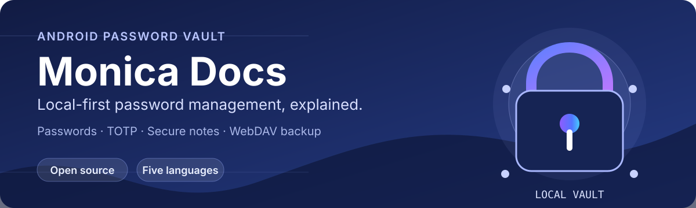

<p align="center">
  <b><a href="README.en.md">English</a></b>
  &nbsp;·&nbsp;
  <b>简体中文</b>
</p>

<p align="center">
  
</p>

<p align="center">
  <a href="https://monica-pass.github.io/MonicaDocs/">浏览文档</a>
  &nbsp;·&nbsp;
  <a href="https://github.com/Monica-Pass/Monica">Monica Android</a>
  &nbsp;·&nbsp;
  <a href="https://github.com/Monica-Pass/Monica/releases">下载 Releases</a>
</p>

# MonicaDocs

MonicaDocs 是 [Monica](https://github.com/Monica-Pass/Monica) 的独立文档站源码。  
Monica 是一款开源、以本地存储优先的 Android 密码管理器，用于管理密码、TOTP 验证码、银行卡与加密便签；  
文档站提供简体中文、English、日本語、Русский和Tiếng Việt内容。  

## 本地运行文档站

环境要求：Node.js 22+ 与 npm。

```bash
npm ci
npm run docs:dev
```

开发服务器默认地址为 `http://localhost:5173/MonicaDocs/`。发布到不同 GitHub Pages 路径时，请同步调整 `.vitepress/config.mts` 的 `base`。

| 命令 | 用途 |
| --- | --- |
| `npm run docs:dev` | 启动本地开发服务器并启用热更新。 |
| `npm run docs:build` | 生成生产构建产物。 |
| `npm run docs:preview` | 本地预览生产构建产物。 |

## 维护说明

- 简体中文内容位于 `01.指南`、`02.配置` 和 `03.生态`；其他语言位于 `en`、`ja`、`ru` 与 `vi`。
- 多语言导航、编辑链接与重写规则位于 `.vitepress/locales/`；主题组件和样式位于 `.vitepress/theme/`。
- GitHub Pages 在推送到 `main` 后通过 Actions 构建 `.vitepress/dist/` 并部署。
- `update-github-commits.yml` 汇总 Monica-Pass 各仓库默认分支最近一年的提交，定时运行，也可通过 `monica-main-updated` 仓库事件或手动触发。
- `update-github-releases.yml` 定时同步 Android、iOS、桌面端、浏览器扩展和 CLI 的 GitHub Releases，也可通过 `monica-release-published` 仓库事件或手动触发。
- 两个同步任务优先使用 `MONICA_SOURCE_REPO_TOKEN`，未配置时使用工作流的 `GITHUB_TOKEN` 读取公开仓库；数据发生变化后会提交并触发网站部署。
- 各源仓库需要配置通知工作流和对 MonicaDocs 具有 Contents 写权限的 `DOCS_REPO_TOKEN`，才能在提交或发布后即时发送 `repository_dispatch`；未配置时仍由定时任务刷新。

## 致谢
- [Monica](https://github.com/Monica-Pass/Monica)

- [VitePress](https://github.com/vuejs/vitepress)
- [Teek](https://github.com/Kele-Bingtang/vitepress-theme-teek)

## 许可证

本仓库以 [GNU General Public License v3.0](./LICENSE) 发布，与 Monica 主项目保持一致。除非文件另有声明，复制、修改和分发时请遵守 GPL-3.0 条款。
